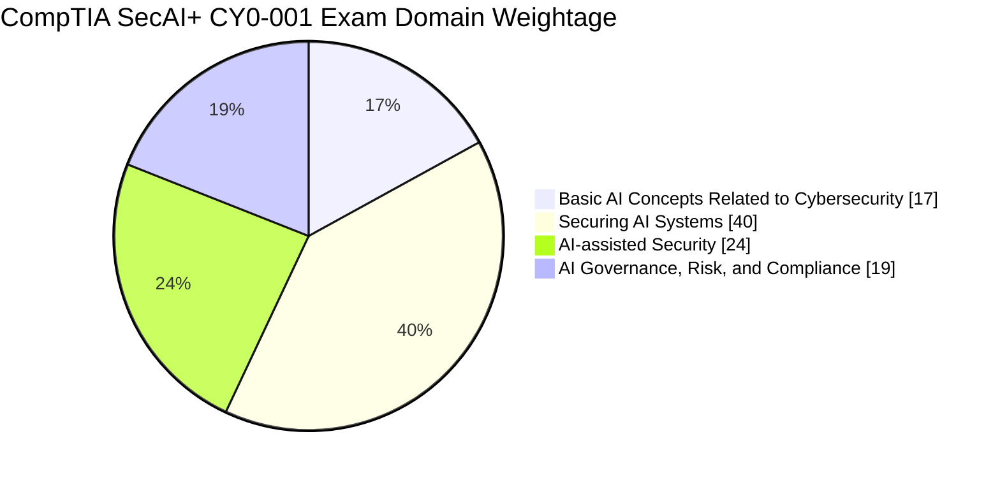
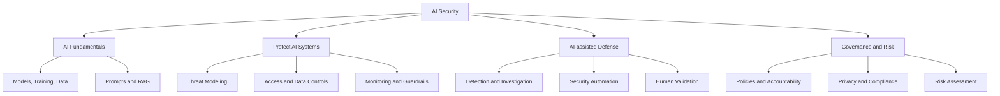
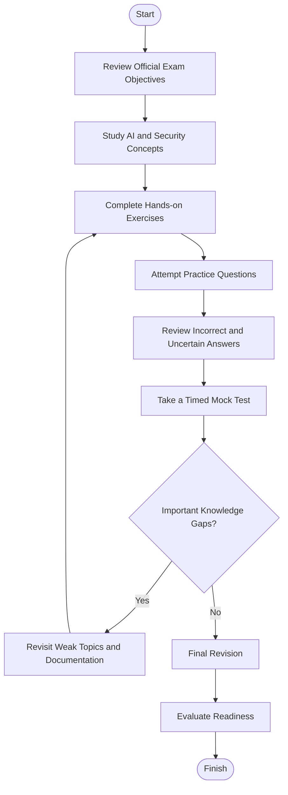
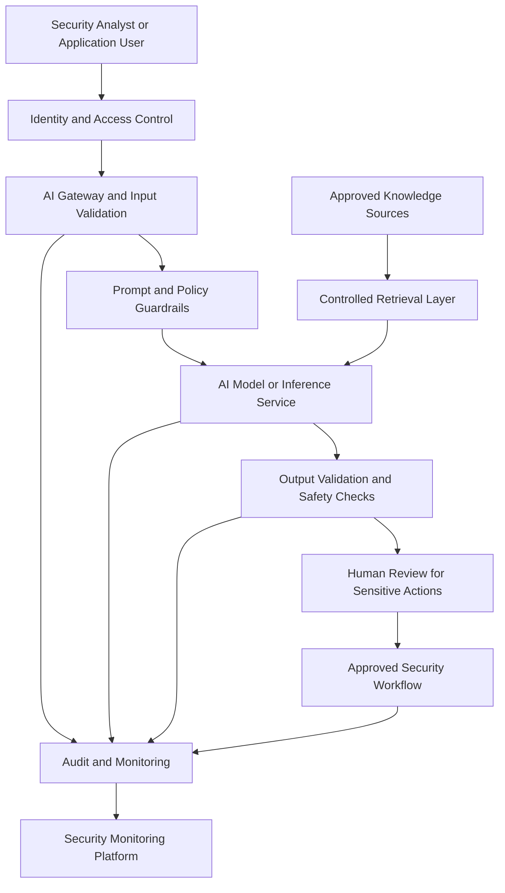
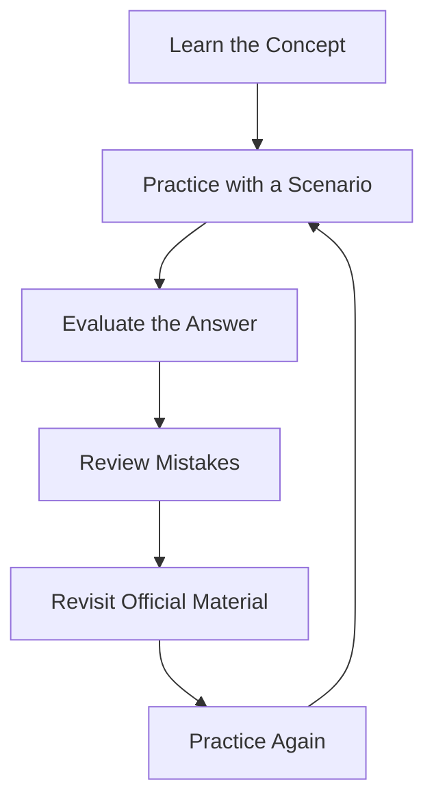
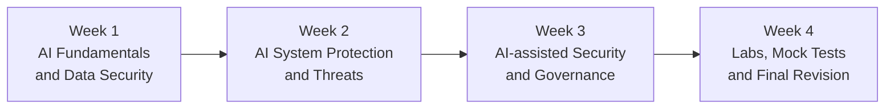

# CompTIA SecAI+ (CY0-001) Study Guide

Prepare for the **CompTIA SecAI+ CY0-001 certification** with a structured learning roadmap covering AI fundamentals, AI system security, AI-assisted cybersecurity, and AI governance, risk, and compliance. This repository brings together exam-domain guidance, practical security scenarios, study diagrams, revision strategies, and original practice questions.

The aim is to help learners understand how AI systems can be secured, how AI can support security operations, and how to evaluate risks before deploying AI in an organization.

> **Study principle:** Use the current official CompTIA exam objectives as your checklist. Combine conceptual learning, hands-on experimentation, practice questions, and review of mistakes rather than relying on memorization alone.

---

## Table of Contents

- [About CompTIA SecAI+](#about-comptia-secai)
- [Who Should Prepare?](#who-should-prepare)
- [Exam Objectives and Domain Weightage](#exam-objectives-and-domain-weightage)
- [AI Security Skills Map](#ai-security-skills-map)
- [Preparation Flowchart](#preparation-flowchart)
- [AI Security Architecture](#ai-security-architecture)
- [Circular Study Cycle](#circular-study-cycle)
- [Step-by-Step Study Plan](#step-by-step-study-plan)
- [Suggested Study Schedule](#suggested-study-schedule)
- [Practice Questions](#practice-questions)
- [Hands-On Labs and Projects](#hands-on-labs-and-projects)
- [Common Preparation Mistakes](#common-preparation-mistakes)
- [Career Relevance](#career-relevance)
- [Frequently Asked Questions](#frequently-asked-questions)
- [Official and Additional Resources](#official-and-additional-resources)
- [About CertsGate](#about-certsgate)

---

## About CompTIA SecAI+

CompTIA SecAI+ is an AI security certification focused on understanding AI technologies, protecting AI systems, applying AI to cybersecurity tasks, and addressing the governance and risk considerations associated with AI adoption.

The exam code is **CY0-001**. Its objectives cover both sides of AI and cybersecurity: protecting AI-powered applications from threats and using AI-enabled tools to support defensive security work.

Important areas include:

- AI and machine-learning fundamentals relevant to cybersecurity.
- Security throughout the AI system life cycle.
- Threat modeling and security controls for AI applications.
- Data protection, access management, monitoring, and auditing.
- AI-enabled threat detection, investigation, and automation.
- AI governance, responsible AI, risk management, and compliance.

Review the [official CompTIA website](https://www.comptia.org/) before scheduling your exam to confirm the latest certification information, objectives, and exam policies.

## Who Should Prepare?

This certification may be relevant to professionals who already understand IT or cybersecurity and want to develop additional knowledge of AI security.

Potential learners include:

- Cybersecurity analysts and security operations professionals.
- Security engineers and architects.
- AI or machine-learning practitioners working with sensitive systems.
- IT professionals responsible for securing AI-enabled applications.
- Risk, governance, and compliance professionals involved in AI adoption.

CompTIA's published objectives describe a recommended background of approximately three to four years of IT experience, including around two years of hands-on cybersecurity experience. Treat this as recommended preparation guidance, not as a substitute for checking current eligibility and exam requirements.

---

## Exam Objectives and Domain Weightage

The published CY0-001 objectives organize the exam into four domains.

| Domain | Official domain weight |
|---|---:|
| 1.0 Basic AI Concepts Related to Cybersecurity | 17% |
| 2.0 Securing AI Systems | 40% |
| 3.0 AI-assisted Security | 24% |
| 4.0 AI Governance, Risk, and Compliance | 19% |
| **Total** | **100%** |

The domain percentages above are from the published exam objectives. They describe the distribution of exam content, not a guaranteed number of questions.

### Domain weightage chart

### Domain 1.0 — Basic AI Concepts Related to Cybersecurity (17%)

Build a reliable understanding of the AI concepts used throughout the exam.

Study topics such as:

- Machine learning, deep learning, generative AI, transformers, and natural language processing.
- Large language models and small language models.
- Supervised, unsupervised, and reinforcement learning.
- Model training, validation, and fine-tuning.
- Prompt engineering and prompt templates.
- Data integrity, data provenance, data processing, and data types.
- Retrieval-augmented generation (RAG), embeddings, and vector storage.
- Security across data collection, development, evaluation, deployment, and maintenance.
- Human oversight and human-in-the-loop approaches.

### Domain 2.0 — Securing AI Systems (40%)

This is the largest domain by published weighting, so give it substantial attention in your preparation.

Focus on:

- AI threat-modeling resources and frameworks.
- Model guardrails and prompt security controls.
- Gateway protections, quotas, rate limits, and endpoint access.
- Model, data, agent, network, and API access controls.
- Encryption and data protection measures.
- Data anonymization, redaction, masking, and minimization.
- Prompt monitoring, log protection, and security auditing.
- Attacks such as prompt injection, data poisoning, model theft, jailbreaking, and sensitive information disclosure.
- Compensating controls and methods for investigating AI-related attacks.

Practice explaining why a control is appropriate for a particular threat instead of simply memorizing control names.

### Domain 3.0 — AI-assisted Security (24%)

Understand how AI can support defensive security work while recognizing the limitations of automated output.

Review:

- AI-enabled security tools and integrations.
- Vulnerability analysis, code quality checks, and anomaly detection.
- Threat modeling, fraud detection, and incident management.
- AI-generated impersonation, misinformation, and social engineering.
- Automated security tasks and incident ticket management.
- AI agents, scripting, and low-code or no-code automation.
- Security testing in continuous integration and continuous delivery (CI/CD) workflows.
- Human review of AI-generated findings and automated actions.

### Domain 4.0 — AI Governance, Risk, and Compliance (19%)

Study the organizational and risk-management requirements that influence AI adoption.

Key areas include:

- AI governance structures, policies, and procedures.
- Responsibilities of AI security, engineering, risk, and audit roles.
- Responsible AI principles, including fairness, transparency, accountability, and privacy.
- Bias, data leakage, intellectual property concerns, and model reliability.
- Business risks associated with autonomous or poorly controlled systems.
- Compliance considerations affecting the development and use of AI technologies.

Use the official objectives document to verify the complete sub-objective list. The topics above are a study overview, not a replacement for that document.

---

## AI Security Skills Map

The following is an **independent conceptual study map**, not an official CompTIA diagram or additional exam weighting.

Use this map to identify connections between domains. For example, understanding how RAG works makes it easier to reason about data access, retrieval security, prompt injection, and monitoring.

---

## Preparation Flowchart

Follow a repeatable process instead of moving directly from reading to mock exams.

The loop is intentional. A wrong answer should lead to an explanation, a targeted review, and another attempt—not just a memorized correction.

---

## AI Security Architecture

The architecture below illustrates a possible AI-enabled security application. It is an educational example, not an official CompTIA reference architecture.

### How to interpret the diagram

- **Identity and access control:** Restricts access to the application, model, data, and tools.
- **AI gateway:** Applies request limits, input checks, and endpoint policies.
- **Prompt guardrails:** Helps enforce application-specific instructions and safety rules.
- **Controlled retrieval:** Limits the information made available to the model.
- **Output validation:** Checks responses before they are used in downstream workflows.
- **Human review:** Keeps consequential actions subject to appropriate oversight.
- **Monitoring:** Records relevant events for investigation, auditing, and improvement.

A guardrail alone cannot eliminate every AI threat. Effective protection requires multiple controls, testing, monitoring, and clear limits on what the AI system is authorized to do.

---

## Circular Study and Revision Cycle

Certification preparation is iterative. Use this cycle for every major objective.

For each practice question, ask yourself:

1. Why is the correct answer appropriate?
2. Why are the other options less suitable?
3. Which exam objective does the question test?
4. Could I explain the same concept in a different scenario?
5. Do I need a lab or additional reading to understand it fully?

Track both incorrect answers and questions you answered correctly by guessing.

---

## Step-by-Step Study Plan

### Step 1: Establish your starting point

Read the current official exam objectives and mark each item as:

- **Strong:** I can explain and apply the concept.
- **Developing:** I recognize the topic but need more practice.
- **Weak:** I cannot confidently explain the concept or select an appropriate control.

Use the results to plan your study time.

### Step 2: Learn the AI fundamentals

Start with model types, training techniques, inference, prompts, data processing, and the AI life cycle.

Create short notes that connect each concept to a security concern. For example, data poisoning affects the trustworthiness of training data, while prompt injection can manipulate how an AI application interprets supplied instructions.

### Step 3: Study AI system protection

Work through the second domain carefully. For each threat, document:

- The attack or failure scenario.
- The asset or process at risk.
- How the threat could be detected.
- Preventive and detective controls.
- The limitations of those controls.
- How the incident should be investigated.

Compare controls rather than assuming one technology solves every problem.

### Step 4: Practice AI-assisted security workflows

Explore how AI can help summarize alerts, categorize incidents, analyze code, identify suspicious patterns, and assist with investigations.

Validate AI output against source evidence. An AI-generated summary can omit important context, and an AI-generated security recommendation can be incorrect.

### Step 5: Review governance and risk

Connect technical controls with organizational responsibilities. Consider who approves an AI use case, who can access sensitive data, who reviews model behavior, and who is accountable when an automated workflow produces an unsafe result.

### Step 6: Practice, analyze, and repeat

Use original questions, scenario exercises, and mock tests to measure progress. For every error, identify the underlying concept and return to the corresponding objective.

Independent practice resources such as [CertsGate](https://certsgate.com/) can supplement this process when relevant materials are available. Verify coverage against the official blueprint.

---

## Suggested Study Schedule

This is an **illustrative four-week plan**, not a CompTIA requirement or a guarantee of readiness. Adjust it according to your existing experience and available study time.

| Week | Main focus | Suggested output |
|---|---|---|
| 1 | Domain 1 and AI life-cycle fundamentals | Concept notes and an AI security glossary |
| 2 | Domain 2 and defensive controls | Threat-to-control matrix and practical exercises |
| 3 | Domains 3 and 4 | AI-assisted security scenarios and governance notes |
| 4 | All domains | Mistake log, practice assessment, and revision checklist |

Because Securing AI Systems represents 40% of the published blueprint, consider allocating extra study and lab time to that domain while still covering all the others.

---

## Practice Questions

These are **original educational practice questions**, not official CompTIA questions and not representations of questions from the live exam. They are intended to test reasoning across the study areas.

### Question 1: Prompt injection

An AI application retrieves internal documentation and uses an LLM to answer employee questions. A document contains instructions that attempt to override the application's intended behavior. What is the best general response?

A. Trust all retrieved documents because they are internal.

B. Treat retrieved content as untrusted input, enforce instruction boundaries, restrict access, and validate outputs.

C. Remove authentication so users can test the application more easily.

D. Disable all logging to prevent disclosure.

**Correct answer: B**

**Explanation:** Retrieved content can contain malicious or irrelevant instructions. Appropriate defenses include treating content as untrusted, limiting the model's permissions, applying suitable guardrails, validating outputs, and monitoring activity.

### Question 2: Data protection

A team wants to send production customer records to an external AI service for analysis. What should it do first?

A. Send all records and check the results afterward.

B. Assess data sensitivity, authorization, privacy requirements, and the service's data-handling controls.

C. Assume the provider automatically removes all sensitive information.

D. Disable encryption to simplify troubleshooting.

**Correct answer: B**

**Explanation:** Data minimization, access control, privacy assessment, and verification of data-handling requirements should precede any transfer of sensitive information.

### Question 3: AI-assisted alert triage

An AI tool summarizes security alerts and recommends closing some of them. What is the safest operational approach?

A. Close every alert recommended by the model.

B. Use the model's confidence as the only decision criterion.

C. Validate recommendations against underlying evidence and apply approved review and escalation procedures.

D. Stop recording alert decisions.

**Correct answer: C**

**Explanation:** AI can support triage, but its output can be incomplete or wrong. Decisions should be evidence-based, logged, and subject to appropriate human oversight.

### Question 4: Model monitoring

After deployment, an AI application begins producing unusually inaccurate responses. Which action is most appropriate?

A. Assume the model cannot change after deployment.

B. Investigate relevant logs and input changes, evaluate model behavior, and apply the established remediation process.

C. Remove all access controls before collecting evidence.

D. Ignore the issue if the service remains available.

**Correct answer: B**

**Explanation:** Monitoring should help identify changes in behavior, possible attacks, data issues, and performance problems. Investigation should follow the organization's approved response process.

### Question 5: AI governance

An organization introduces an AI system that processes sensitive information, but no team owns its risk review. What should be addressed?

A. Governance responsibilities, policies, risk assessment, and accountability.

B. Only the user interface.

C. Only the model's response speed.

D. Removal of audit records.

**Correct answer: A**

**Explanation:** AI governance establishes responsibilities and processes for evaluating risk, protecting information, meeting applicable requirements, and maintaining accountability.

### How to use practice questions

- Answer each question before reading its explanation.
- Explain why each alternative is less suitable.
- Identify the domain and objective related to the question.
- Revisit the underlying material if your answer was uncertain.
- Create new scenarios and compare different controls.
- Use timed mock tests to assess both knowledge and decision-making under time constraints.

Third-party question banks can help with repetition, but do not assume that any practice set exactly reproduces the official exam.

---

## Hands-On Labs and Projects

You can develop practical understanding with small, controlled exercises. Use synthetic data and systems you are authorized to test.

### Lab 1: Build an AI threat model

Choose a simple LLM-powered application and document:

- Assets, users, trust boundaries, and data flows.
- Potential prompt injection and data disclosure risks.
- Access controls and output validation.
- Logging, monitoring, and incident response.
- Residual risks after controls are applied.

Use the [MITRE ATLAS knowledge base](https://atlas.mitre.org/) and the [OWASP GenAI Security Project](https://genai.owasp.org/) as supporting references.

### Lab 2: Test a controlled retrieval workflow

Build or diagram a small retrieval-augmented generation workflow using non-sensitive sample documents.

Test whether:

- Users can retrieve only authorized material.
- Untrusted document content is handled safely.
- The application validates responses before displaying or acting on them.
- Logs avoid unnecessary exposure of confidential data.

Record observed limitations and improvements. Do not treat a successful test as proof that the application is completely secure.

### Lab 3: Design AI-assisted alert triage

Create synthetic security alerts and ask an AI tool to categorize and summarize them. Compare its output with your own assessment.

Measure the quality of the result by checking:

- Whether important evidence was preserved.
- Whether the summary introduced unsupported claims.
- Whether severity and escalation decisions were reasonable.
- Whether a human reviewer could trace the recommendation to its source.

### Lab 4: Create a monitoring checklist

Draft a checklist for an AI service covering:

- Authentication and authorization events.
- Prompt and response monitoring, with privacy safeguards.
- Access and configuration changes.
- Unusual usage patterns and resource consumption.
- Output quality, errors, and potential policy violations.
- Audit-log integrity and incident escalation.

The objective is to understand the security reasoning behind monitoring, not to deploy a production service without a proper security review.

---

## Common Preparation Mistakes

### Memorizing terms without understanding the scenarios

Knowing the definition of prompt injection is not enough. Practice identifying the threat, choosing suitable controls, and explaining why other approaches are weaker.

### Neglecting the highest-weighted domain

Securing AI Systems accounts for 40% of the published exam blueprint. Give it sufficient study time without ignoring the other domains.

### Treating AI output as reliable evidence

AI-generated explanations and recommendations can contain errors. Learn to verify findings against logs, source data, system behavior, and trusted documentation.

### Skipping hands-on practice

Reading about access controls or model monitoring is different from designing and evaluating them. Practical exercises help connect concepts with operational decisions.

### Ignoring governance

Technical controls cannot resolve every issue involving privacy, accountability, acceptable use, or compliance. Study how organizational policies support technical safeguards.

### Repeating mock tests without reviewing mistakes

A score is useful only when it helps identify what to improve. Keep a mistake log and revisit the objectives connected to recurring errors.

### Relying on unauthorized exam dumps

Use legitimate educational materials and original practice exercises. Memorized or unauthorized purported live-exam content does not provide a reliable foundation for professional competence.

---

## Career Relevance

AI is increasingly used in application development, data analysis, security operations, and business workflows. Organizations adopting these systems also need to consider access control, data protection, model behavior, monitoring, governance, and incident response.

The knowledge covered by SecAI+ may be relevant to work involving:

- AI security assessments.
- Cybersecurity operations and AI-assisted investigation.
- AI application security.
- Security engineering and architecture.
- AI risk, governance, and compliance.
- Secure deployment and monitoring of AI-enabled systems.

A certification can help structure learning and demonstrate knowledge of a defined subject area. It does not by itself guarantee employment, a promotion, or proficiency in every real-world environment.

---

## Frequently Asked Questions

### What is the CompTIA SecAI+ CY0-001 certification?

It is a CompTIA certification focused on AI concepts related to cybersecurity, securing AI systems, AI-assisted security work, and AI governance, risk, and compliance.

### What are the four CY0-001 exam domains?

The published weights are:

- Basic AI Concepts Related to Cybersecurity — 17%.
- Securing AI Systems — 40%.
- AI-assisted Security — 24%.
- AI Governance, Risk, and Compliance — 19%.

Always verify that your study material matches the current official objectives.

### Which domain should I prioritize?

Securing AI Systems has the largest published weighting at 40%. Prioritize it appropriately, but prepare across all four domains.

### Should I use practice questions?

Yes, as one part of a broader plan. Combine questions with official objectives, technical reading, controlled labs, and careful review of incorrect or uncertain answers.

### Are the practice questions in this repository official exam questions?

No. They are original educational examples created to support learning. They are not represented as official, live, leaked, or guaranteed exam questions.

### Where can I find official exam information?

Start with [CompTIA](https://www.comptia.org/) and locate the SecAI+ certification page and current CY0-001 objectives. Confirm the latest exam policies and details directly with the provider.

### Can CertsGate replace official CompTIA resources?

No. CertsGate is an independent preparation resource. Use any relevant study guides or practice questions as supplementary material and verify technical coverage against the official objectives.

### How do I know when I am ready?

Readiness is stronger when you can explain concepts without notes, apply controls to unfamiliar scenarios, justify why alternative approaches are less suitable, and identify your own knowledge gaps. A single mock-test score is not a guarantee of an exam result.

---

## Official and Additional Resources

Use official documentation first, then consult relevant technical references for deeper study.

### CompTIA

- [CompTIA official website](https://www.comptia.org/) — certification information, current exam details, and official learning resources.
- [CompTIA certification catalog](https://www.comptia.org/en-us/certifications) — browse the provider's certification offerings and locate SecAI+.
- [CompTIA SecAI+ certification information](https://www.comptia.org/en-us/certifications/secai) — check this page for current availability and official details. If the URL changes, use the certification catalog to locate the current page.

### AI and cybersecurity references

- [OWASP GenAI Security Project](https://genai.owasp.org/) — security risks and guidance for generative AI applications.
- [MITRE ATLAS](https://atlas.mitre.org/) — adversarial threats and techniques involving AI-enabled systems.
- [NIST AI Risk Management Framework](https://www.nist.gov/itl/ai-risk-management-framework) — a framework for managing risks associated with AI.
- [NIST Cybersecurity Framework](https://www.nist.gov/cyberframework) — cybersecurity risk management guidance.
- [NIST Computer Security Resource Center](https://csrc.nist.gov/) — security publications and technical resources.

These references support independent study. They are not substitutes for the current CompTIA exam objectives, and their inclusion does not imply that every resource is explicitly tested on CY0-001.

---

## About CertsGate

[CertsGate](https://certsgate.com/) is an independent IT certification preparation website. Learners preparing for CompTIA SecAI+ may use relevant study guides, practice questions, and mock-test materials as supplementary tools when available.

A practical study approach is to:

1. Review the official exam objectives.
2. Learn each technical concept using reliable documentation.
3. Practice with controlled exercises and scenario-based questions.
4. Review errors and revisit weak areas.
5. Evaluate readiness across all exam domains.

CertsGate is not presented here as an official CompTIA partner or certification provider. Verify all exam-specific details with CompTIA.
